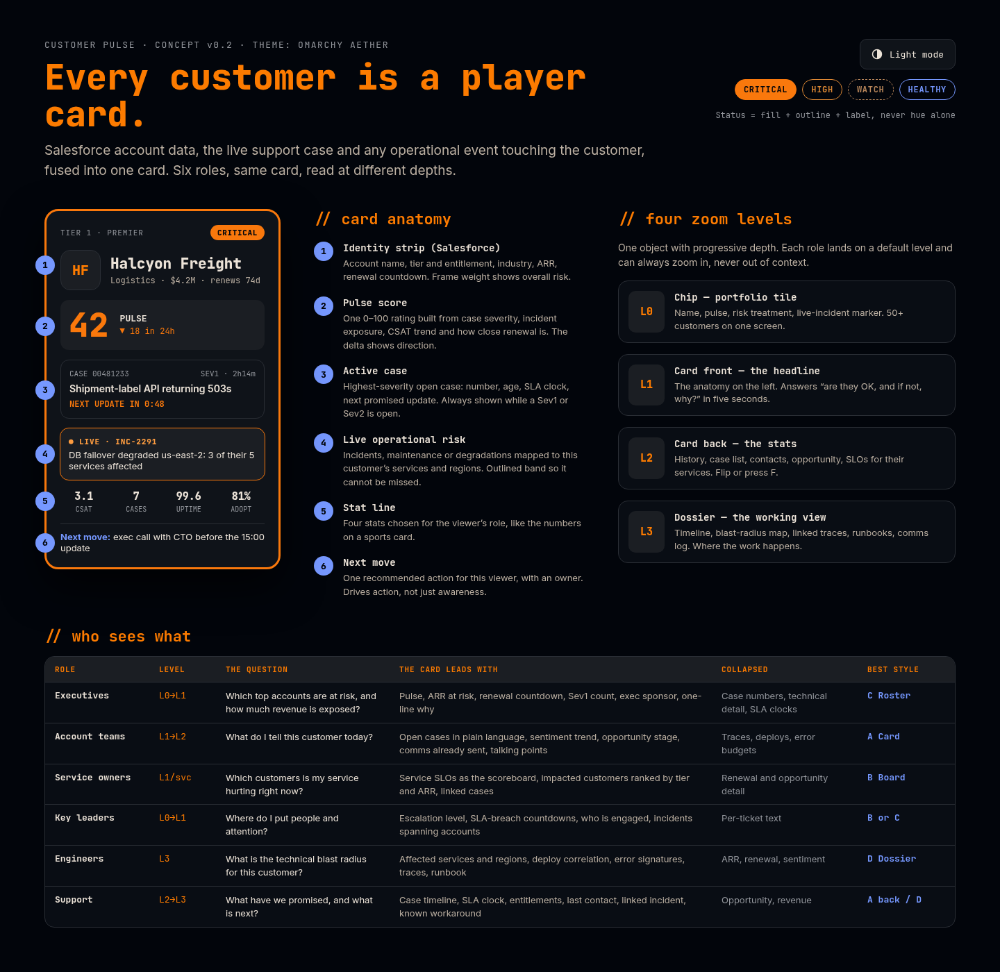
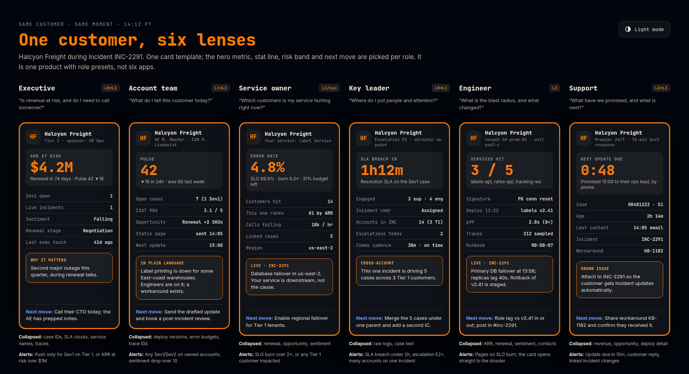
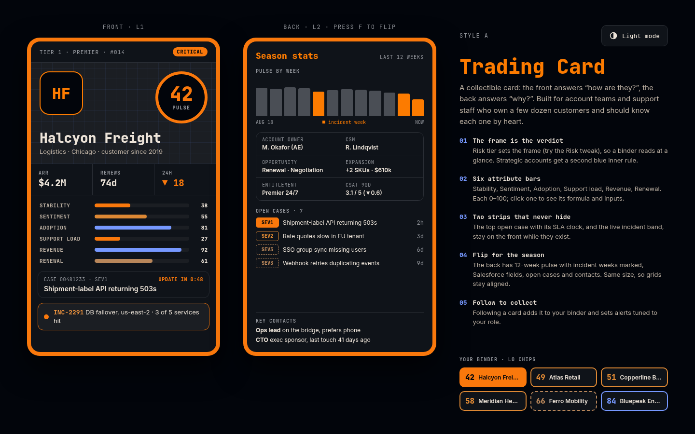
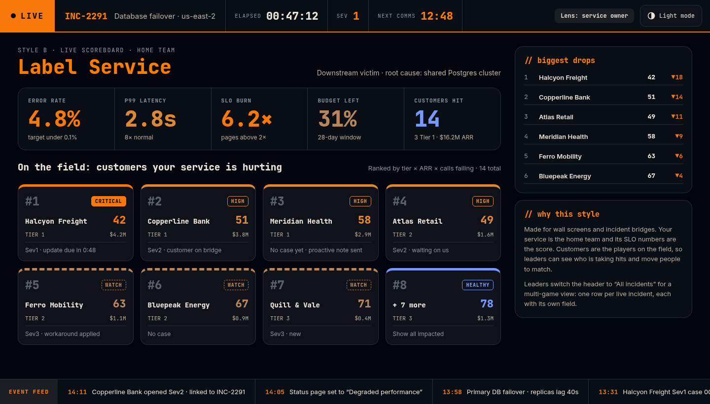
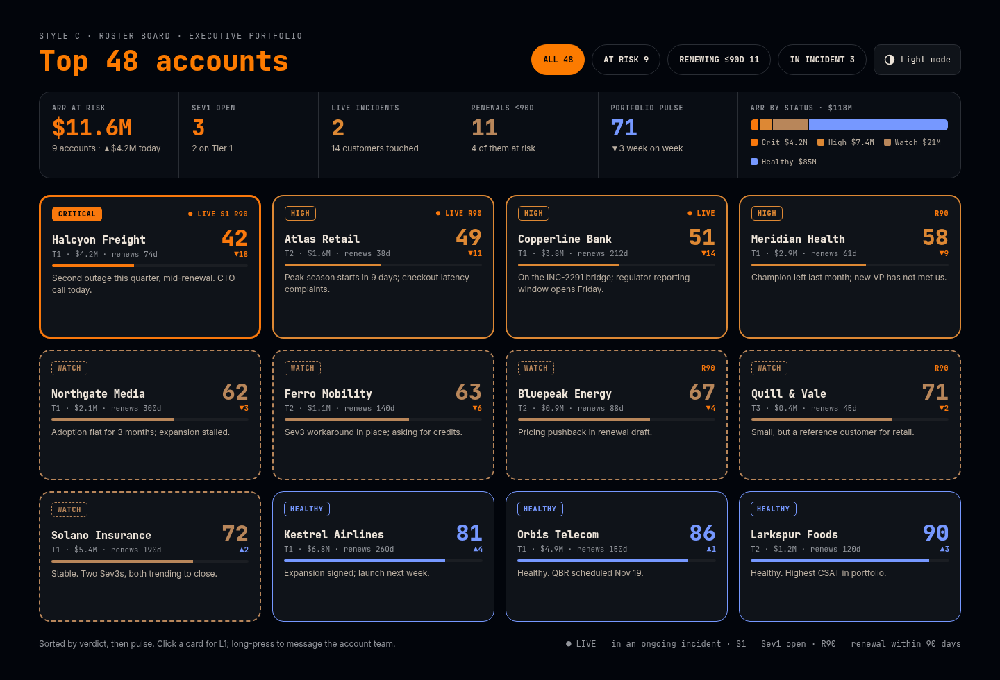
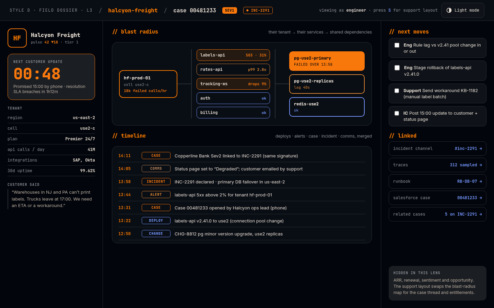

# Customer Pulse

**Every customer is a player card.** Salesforce account data, the live support case and any operational event touching that customer, fused into one card that six roles read at four depths.

> Status: **concept & build plan.** Nothing is built yet, on purpose. This repo holds the mockups, the plan, the data contract and the briefs that build agents execute.

| | |
|---|---|
| 🎴 **Mockups** | [`design/project/`](design/project/): six artboards (concept, six-lens ladder, four display styles). Dark by default with a working light toggle, themed on the Omarchy **Aether** palette. |
| 🗺 **Plan** | [`docs/PLAN.md`](docs/PLAN.md): card anatomy, zoom levels L0–L3, role lenses, pulse score formula, data model, style comparison, roadmap, open questions |
| 📐 **Contract** | [`contracts/types.ts`](contracts/types.ts) + [`data/fixtures/portfolio.json`](data/fixtures/portfolio.json), the scenario every agent builds against |
| 🤖 **Agent briefs** | [`prompts/`](prompts/): `00` foundation → `01–04` the four styles (in parallel) → `05` lenses & alerts → `06` live integrations |
| 🎨 **Theme** | [`design/tokens/aether.css`](design/tokens/aether.css) + [`scripts/omarchy-theme-to-css.sh`](scripts/omarchy-theme-to-css.sh), which turns your live Omarchy theme into `--cp-*` tokens |

## The four styles

| Style | For | One-liner |
|-------|-----|-----------|
| **A · Trading Card** | Account teams, support | Collectible front/back card with attribute bars; follow cards into a personal binder |
| **B · Live Scoreboard** | Service owners, leaders | Broadcast view: your service is the home team, impacted customers are on the field |
| **C · Roster Board** | Executives | Draft-board portfolio with ARR-at-risk strip and one-line "why" per account |
| **D · Field Dossier** | Engineers, support | Terminal-style L3: blast radius, merged timeline with suspect deploys, next moves |

Recommended build order: **C + A first** (they share one card component), then B, then D. The reasons are in `docs/PLAN.md §7`.

## The scenario

All mockups and fixtures show one moment: **14:12 PT**, incident **INC-2291** (database failover, us-east-2) is hurting 14 customers. The hero is **Halcyon Freight**: Tier 1, $4.2M ARR, renewal in 74 days, a Sev1 open with the next customer update due in 48 minutes. Its pulse is 42 (Critical), and the breakdown in the fixture reproduces that number exactly.

All companies, people and numbers are fictional.

## Viewing the mockups

PNG previews of every board, in both themes, are in [`design/previews/`](design/previews/):

| | |
|---|---|
|  |  |
|  |  |
|  |  |

The sources are `design/project/*.dc.html`, Design Component artboards (a canvas format with a live light/dark toggle). Each has a `renderVals()` block holding the exact copy and numbers. Build agents treat those blocks as the visual spec.

To validate and re-render after editing an artboard:

```bash
node scripts/check-artboards.mjs design/project/*.dc.html
```

```bash
node scripts/render-artboards.mjs /tmp/out design/project/*.dc.html
```

The first checks that every `{{hole}}` resolves and tags balance, in both themes. The second writes static HTML per theme; screenshot those with headless Chromium.

## Regenerating theme tokens

```bash
scripts/omarchy-theme-to-css.sh > app/src/theme/omarchy.css
```

This reads `~/.local/state/omarchy/current/theme/colors.toml` (or a path you pass in). If no theme is found, it falls back to the checked-in Aether tokens.
